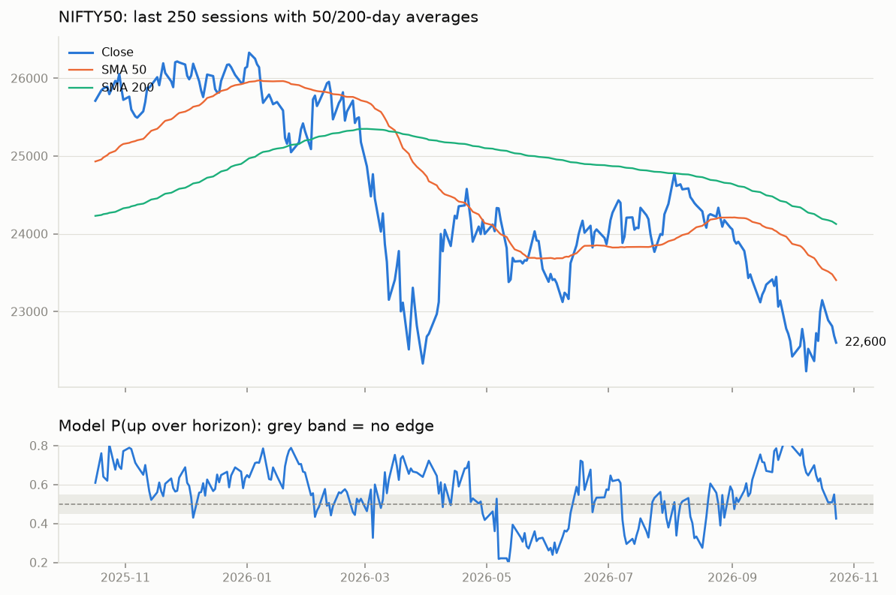
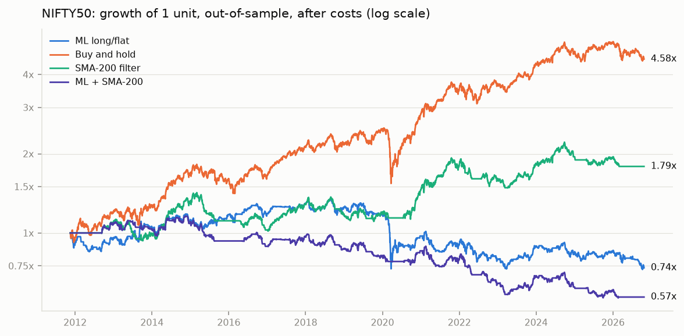
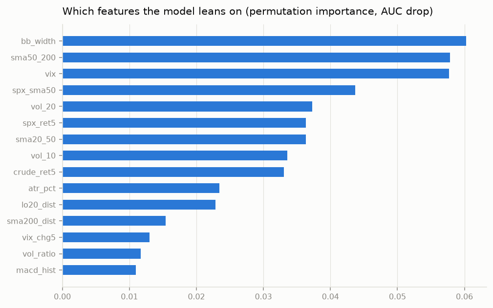

## NIFTY50 daily read: 2026-10-23

Close **22,600.00** (2026-10-23). Model P(up over next 5 sessions) = **0.457**: NO EDGE - coin flip, stay out or size tiny.

## How much to trust it

Walk-forward out-of-sample: accuracy 0.519, balanced 0.493, AUC 0.501, always-up baseline 0.567 over 3660 predictions. **No proven edge** (AUC ~0.5): treat the probability as noise. Close is below the 200-day SMA.

| strategy | CAGR | max DD | Sharpe | switches |
|---|---|---|---|---|
| ml | -2.0% | -46.0% | -0.09 | 572 |
| sma200 | +4.0% | -28.6% | 0.42 | 122 |
| combo | -3.7% | -51.2% | -0.39 | 484 |
| buy_and_hold | +10.7% | -38.4% | 0.73 | 1 |

Costs 20.0 bps per switch; ml enters above 0.55, exits below 0.50.

## NIFTY 50 swing scan: strongest

| symbol     |    close |   score |   rsi14 |   ret_1m |   rel_3m |   from_20d_high |   atr_pct |
|:-----------|---------:|--------:|--------:|---------:|---------:|----------------:|----------:|
| ICICIBANK  |  1394.2  |     4.2 |      57 |      4.1 |      3.3 |            -1.2 |       1.8 |
| TECHM      |  1790    |     3.7 |      72 |     16.3 |     21.3 |            -3   |       3   |
| BHARTIARTL |  1892.1  |     3.6 |      59 |      4.1 |      4.5 |            -1.9 |       2.3 |
| ETERNAL    |   317.4  |     3.5 |      47 |     -7.2 |     15.9 |            -7.6 |       3.2 |
| INFY       |  1153.8  |     3.3 |      64 |     12.1 |     15.5 |            -3.7 |       3.6 |
| TCS        |  2530    |     3.1 |      75 |     20.8 |     18.7 |            -3.6 |       3   |
| KOTAKBANK  |   430.5  |     3   |      52 |      4.3 |     17.6 |            -5   |       2.2 |
| ULTRACEMCO | 11050    |     2.9 |      54 |      0.5 |      0   |            -1.5 |       2.4 |
| WIPRO      |   189.84 |     2.5 |      73 |     14.4 |     15.2 |            -3.8 |       2.7 |
| DRREDDY    |  1229.5  |     2.4 |      55 |      1.5 |     10.7 |            -1.9 |       2.2 |

## NIFTY 50 swing scan: weakest

| symbol     |   close |   score |   rsi14 |   ret_1m |   rel_3m |
|:-----------|--------:|--------:|--------:|---------:|---------:|
| SBILIFE    |  1640   |       0 |      37 |     -6.6 |     -6.2 |
| SHRIRAMFIN |   865   |       0 |      30 |    -14   |    -10.4 |
| SUNPHARMA  |  1748   |       0 |      37 |     -5.3 |     -5.2 |
| POWERGRID  |   247.4 |       0 |      36 |     -7   |     -8.9 |
| TMPV       |   264.6 |       0 |      30 |    -11.8 |    -13.1 |

## Disclaimer

Educational tool. Out-of-sample accuracy on daily direction is typically 52-56%. A probability is a lean, not a forecast. Risk only what the position-size rule allows.
