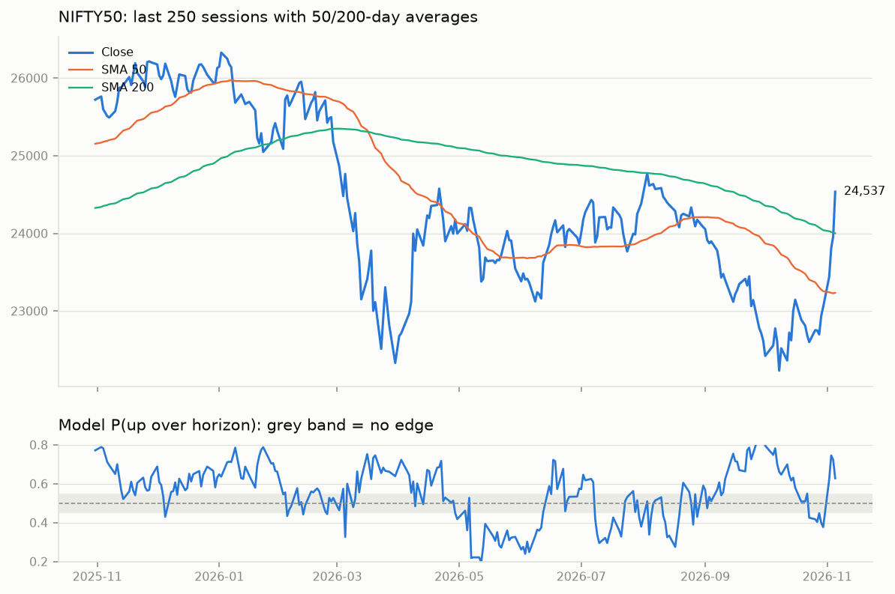
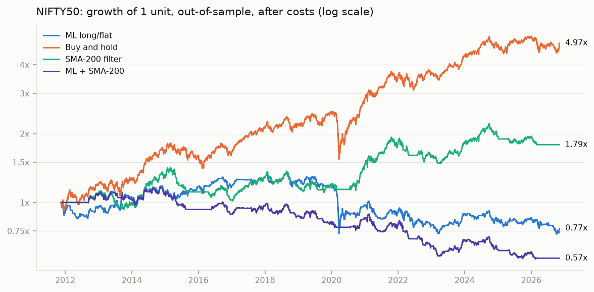
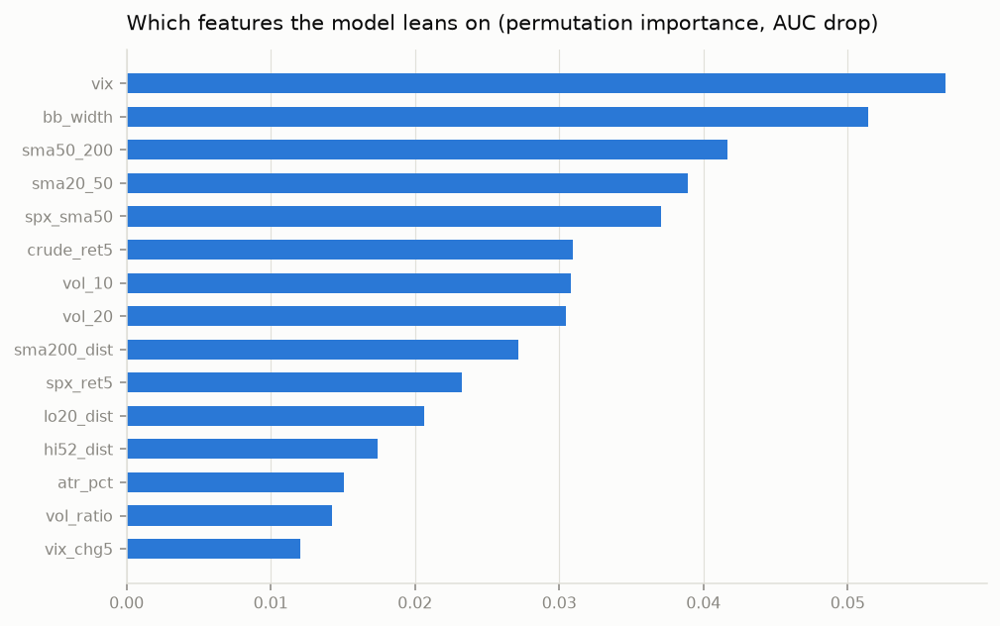

## NIFTY50 daily read: 2026-11-05

Close **24,536.60** (2026-11-05). Model P(up over next 5 sessions) = **0.662**: BULLISH lean (strong for this model).

## How much to trust it

Walk-forward out-of-sample: accuracy 0.518, balanced 0.492, AUC 0.500, always-up baseline 0.568 over 3669 predictions. **No proven edge** (AUC ~0.5): treat the probability as noise. Close is above the 200-day SMA.

| strategy | CAGR | max DD | Sharpe | switches |
|---|---|---|---|---|
| ml | -1.7% | -46.0% | -0.06 | 573 |
| sma200 | +4.0% | -28.6% | 0.41 | 123 |
| combo | -3.7% | -51.2% | -0.39 | 485 |
| buy_and_hold | +11.3% | -38.4% | 0.76 | 1 |

Costs 20.0 bps per switch; ml enters above 0.55, exits below 0.50.

## NIFTY 50 swing scan: strongest

| symbol     |   close |   score |   rsi14 |   ret_1m |   rel_3m |   from_20d_high |   atr_pct |
|:-----------|--------:|--------:|--------:|---------:|---------:|----------------:|----------:|
| JSWSTEEL   |  1355.6 |     4.2 |      68 |      7.6 |      2.3 |            -1.1 |       2.4 |
| ADANIPORTS |  1884.6 |     4.2 |      63 |      5.7 |     11.2 |            -3.3 |       2.7 |
| EICHERMOT  |  7713   |     4.1 |      67 |      9.4 |     -3.1 |             0   |       2.2 |
| TITAN      |  4834.6 |     4.1 |      68 |      6.3 |     -1.2 |            -0.5 |       2.2 |
| CIPLA      |  1404.1 |     4   |      65 |      4.8 |     -3.4 |            -0.3 |       1.9 |
| ETERNAL    |   358.3 |     3.9 |      67 |      8.9 |     15.8 |            -0.4 |       2.9 |
| BAJFINANCE |  1070   |     3.9 |      70 |     11.1 |     -7.3 |            -0.5 |       2.8 |
| KOTAKBANK  |   467   |     3.8 |      68 |      8.1 |     17.1 |            -1.2 |       2.2 |
| ICICIBANK  |  1500   |     3.7 |      73 |     11.7 |      3.8 |            -0.1 |       2   |
| SUNPHARMA  |  1829   |     3.7 |      61 |      1.4 |     -5.4 |            -1.4 |       2.2 |

## NIFTY 50 swing scan: weakest

| symbol     |   close |   score |   rsi14 |   ret_1m |   rel_3m |
|:-----------|--------:|--------:|--------:|---------:|---------:|
| TATACONSUM |  1077.7 |     2.1 |      70 |     10.4 |     -1.3 |
| TCS        |  2495.7 |     2   |      63 |     19.5 |      4.3 |
| SBILIFE    |  1735   |     1.9 |      61 |     -0.9 |     -7.4 |
| HINDUNILVR |  1982   |     1.7 |      66 |      4.6 |     -4.6 |
| NESTLEIND  |  1258.3 |     1   |      49 |     -6.2 |    -16.9 |

## Disclaimer

Educational tool. Out-of-sample accuracy on daily direction is typically 52-56%. A probability is a lean, not a forecast. Risk only what the position-size rule allows.
