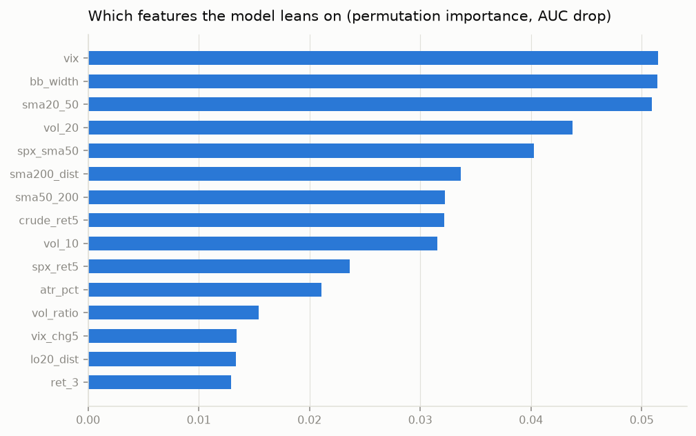

## NIFTY50 daily read: 2026-11-17

Close **25,291.10** (2026-11-16). Model P(up over next 5 sessions) = **0.683**: BULLISH lean (strong for this model).

## How much to trust it

Walk-forward out-of-sample: accuracy 0.518, balanced 0.492, AUC 0.501, always-up baseline 0.568 over 3675 predictions. **No proven edge** (AUC ~0.5): treat the probability as noise. Close is above the 200-day SMA.

| strategy | CAGR | max DD | Sharpe | switches |
|---|---|---|---|---|
| ml | -1.5% | -46.0% | -0.05 | 573 |
| sma200 | +4.2% | -28.6% | 0.43 | 123 |
| combo | -3.5% | -51.2% | -0.36 | 485 |
| buy_and_hold | +11.5% | -38.4% | 0.77 | 1 |

Costs 20.0 bps per switch; ml enters above 0.55, exits below 0.50.

## NIFTY 50 swing scan: strongest

| symbol     |   close |   score |   rsi14 |   ret_1m |   rel_3m |   from_20d_high |   atr_pct |
|:-----------|--------:|--------:|--------:|---------:|---------:|----------------:|----------:|
| AXISBANK   |  1342.4 |     3.8 |      68 |      6.2 |      6.2 |            -1.3 |       2.1 |
| INDIGO     |  5544   |     3.6 |      70 |     17.5 |     -0.4 |            -3   |       2.6 |
| CIPLA      |  1394.5 |     3.6 |      56 |      6.1 |     -8.1 |            -1.9 |       1.8 |
| ICICIBANK  |  1585   |     3.3 |      76 |     18.4 |      9   |            -1.9 |       2   |
| HDFCLIFE   |   604.5 |     3.3 |      74 |     11.1 |      8.7 |            -0.9 |       2.6 |
| TRENT      |  3203.7 |     3.2 |      68 |      7.8 |      3.5 |            -1.1 |       2.5 |
| HDFCBANK   |   816.5 |     3.2 |      76 |     14.9 |      9   |            -0.2 |       2.1 |
| APOLLOHOSP |  8771   |     3.1 |      64 |     12.1 |     -1.6 |            -0.2 |       2.3 |
| ETERNAL    |   371.1 |     3.1 |      71 |     17.4 |     13   |            -0.4 |       2.6 |
| EICHERMOT  |  7599   |     3.1 |      59 |      7.3 |     -9.9 |            -4.4 |       2.7 |

## NIFTY 50 swing scan: weakest

| symbol     |   close |   score |   rsi14 |   ret_1m |   rel_3m |
|:-----------|--------:|--------:|--------:|---------:|---------:|
| SHRIRAMFIN |  978.4  |     1.4 |      58 |      3.8 |    -16.6 |
| JIOFIN     |  226    |     1.3 |      57 |      3.2 |    -15.3 |
| NTPC       |  321.25 |     1.2 |      55 |      3.4 |     -8.4 |
| INFY       | 1145.1  |     1.2 |      56 |      7.7 |     -4   |
| TMPV       |  262.4  |     1   |      37 |     -7.5 |    -28.6 |

## Disclaimer

Educational tool. Out-of-sample accuracy on daily direction is typically 52-56%. A probability is a lean, not a forecast. Risk only what the position-size rule allows.
