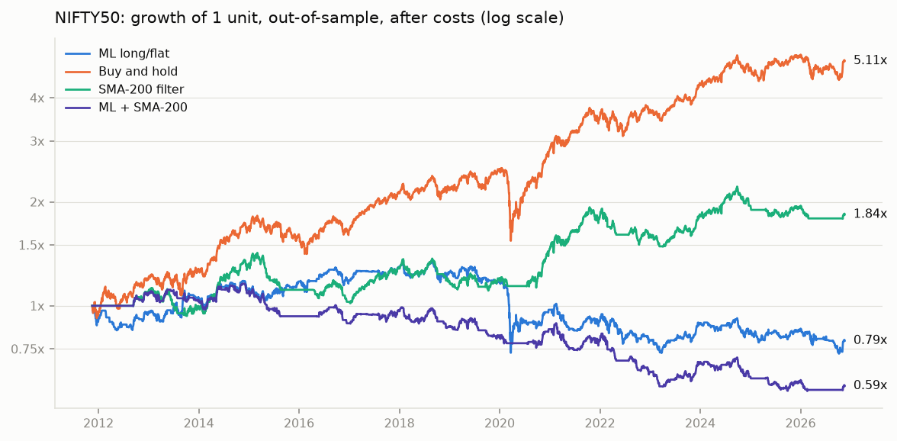

## NIFTY50 daily read: 2026-11-19

Close **25,227.95** (2026-11-18). Model P(up over next 5 sessions) = **0.582**: mild bullish lean.

## How much to trust it

Walk-forward out-of-sample: accuracy 0.518, balanced 0.492, AUC 0.501, always-up baseline 0.568 over 3677 predictions. **No proven edge** (AUC ~0.5): treat the probability as noise. Close is above the 200-day SMA.

| strategy | CAGR | max DD | Sharpe | switches |
|---|---|---|---|---|
| ml | -1.5% | -46.0% | -0.05 | 573 |
| sma200 | +4.1% | -28.6% | 0.43 | 123 |
| combo | -3.5% | -51.2% | -0.37 | 485 |
| buy_and_hold | +11.5% | -38.4% | 0.77 | 1 |

Costs 20.0 bps per switch; ml enters above 0.55, exits below 0.50.

## NIFTY 50 swing scan: strongest

| symbol     |   close |   score |   rsi14 |   ret_1m |   rel_3m |   from_20d_high |   atr_pct |
|:-----------|--------:|--------:|--------:|---------:|---------:|----------------:|----------:|
| CIPLA      | 1417    |     3.8 |      62 |      6.9 |     -4.9 |            -1.3 |       1.9 |
| ITC        |  296.6  |     3.2 |      72 |     12.6 |      4.8 |            -0.5 |       2.3 |
| ETERNAL    |  366    |     3.2 |      64 |     12.5 |     11.2 |            -3.2 |       2.7 |
| DRREDDY    | 1398.2  |     3.1 |      74 |     13.4 |     13.4 |            -0.6 |       1.9 |
| BHARTIARTL | 2132    |     3.1 |      69 |     11.9 |      4.4 |            -1.9 |       2.1 |
| TRENT      | 3190    |     3   |      66 |      7.8 |      4.4 |            -2.2 |       2.6 |
| KOTAKBANK  |  494.85 |     3   |      74 |     10.6 |     22.1 |            -1.6 |       2   |
| ADANIPORTS | 1902.6  |     2.9 |      58 |      8.7 |      8.6 |            -3.9 |       2.5 |
| AXISBANK   | 1360    |     2.9 |      69 |      5.4 |      6.9 |            -1.1 |       2   |
| APOLLOHOSP | 8821    |     2.9 |      64 |     11.8 |     -3.9 |            -0.9 |       2.3 |

## NIFTY 50 swing scan: weakest

| symbol    |   close |   score |   rsi14 |   ret_1m |   rel_3m |
|:----------|--------:|--------:|--------:|---------:|---------:|
| NTPC      |  320.4  |     1.2 |      54 |      2.6 |     -6.9 |
| WIPRO     |  185.14 |     1.1 |      46 |      0.4 |     -2.1 |
| INFY      | 1108.8  |     1   |      48 |     -2.3 |     -4.4 |
| TATASTEEL |  179    |     1   |      49 |      2   |     -7.6 |
| TMPV      |  252.55 |     1   |      32 |    -12   |    -27.4 |

## Disclaimer

Educational tool. Out-of-sample accuracy on daily direction is typically 52-56%. A probability is a lean, not a forecast. Risk only what the position-size rule allows.
