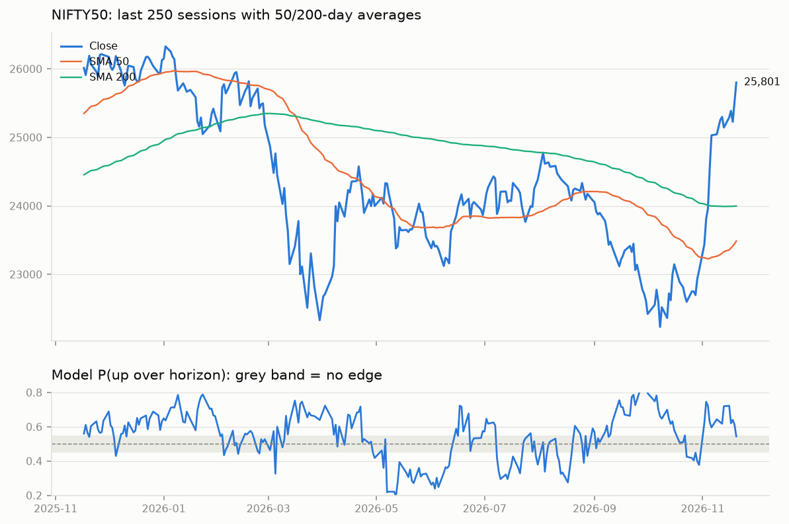

## NIFTY50 daily read: 2026-11-23

Close **25,800.60** (2026-11-20). Model P(up over next 5 sessions) = **0.622**: BULLISH lean (strong for this model).

## How much to trust it

Walk-forward out-of-sample: accuracy 0.519, balanced 0.492, AUC 0.501, always-up baseline 0.569 over 3679 predictions. **No proven edge** (AUC ~0.5): treat the probability as noise. Close is above the 200-day SMA.

| strategy | CAGR | max DD | Sharpe | switches |
|---|---|---|---|---|
| ml | -1.4% | -46.0% | -0.04 | 573 |
| sma200 | +4.3% | -28.6% | 0.44 | 123 |
| combo | -3.4% | -51.2% | -0.35 | 485 |
| buy_and_hold | +11.7% | -38.4% | 0.78 | 1 |

Costs 20.0 bps per switch; ml enters above 0.55, exits below 0.50.

## NIFTY 50 swing scan: strongest

| symbol     |   close |   score |   rsi14 |   ret_1m |   rel_3m |   from_20d_high |   atr_pct |
|:-----------|--------:|--------:|--------:|---------:|---------:|----------------:|----------:|
| CIPLA      | 1415    |     3.7 |      61 |      7.7 |     -7.6 |            -1.4 |       1.8 |
| DRREDDY    | 1390.2  |     3.6 |      69 |     11.7 |     11.7 |            -1.1 |       1.8 |
| TRENT      | 3256.1  |     3.3 |      70 |     15.4 |      3.1 |            -0.6 |       2.5 |
| APOLLOHOSP | 9200    |     3.3 |      70 |     21.1 |     -2   |            -0.9 |       2.4 |
| EICHERMOT  | 8113    |     3.2 |      70 |     13.1 |     -5.6 |            -0.4 |       2.6 |
| AXISBANK   | 1446    |     3.2 |      78 |     19.5 |      9.9 |            -0.3 |       2.2 |
| HDFCLIFE   |  588.65 |     3.2 |      62 |      9.1 |      2.6 |            -3.5 |       2.6 |
| GRASIM     | 3103.7  |     3.2 |      54 |      7.4 |    -12.2 |            -4.2 |       2.2 |
| ITC        |  299.1  |     3.1 |      72 |     14.2 |      4.8 |            -0.9 |       2.2 |
| BAJFINANCE | 1122    |     3   |      68 |     21.2 |     -3.3 |            -0.4 |       2.7 |

## NIFTY 50 swing scan: weakest

| symbol    |   close |   score |   rsi14 |   ret_1m |   rel_3m |
|:----------|--------:|--------:|--------:|---------:|---------:|
| NTPC      |  321.5  |     1.3 |      54 |      7.1 |     -9.7 |
| JIOFIN    |  224.97 |     1.2 |      54 |      6.4 |    -14.6 |
| WIPRO     |  185.7  |     1.1 |      47 |     -1.8 |     -3.7 |
| INFY      | 1098    |     1   |      46 |     -3.8 |     -6.9 |
| TATASTEEL |  178    |     1   |      47 |      3.2 |    -10.4 |

## Disclaimer

Educational tool. Out-of-sample accuracy on daily direction is typically 52-56%. A probability is a lean, not a forecast. Risk only what the position-size rule allows.
